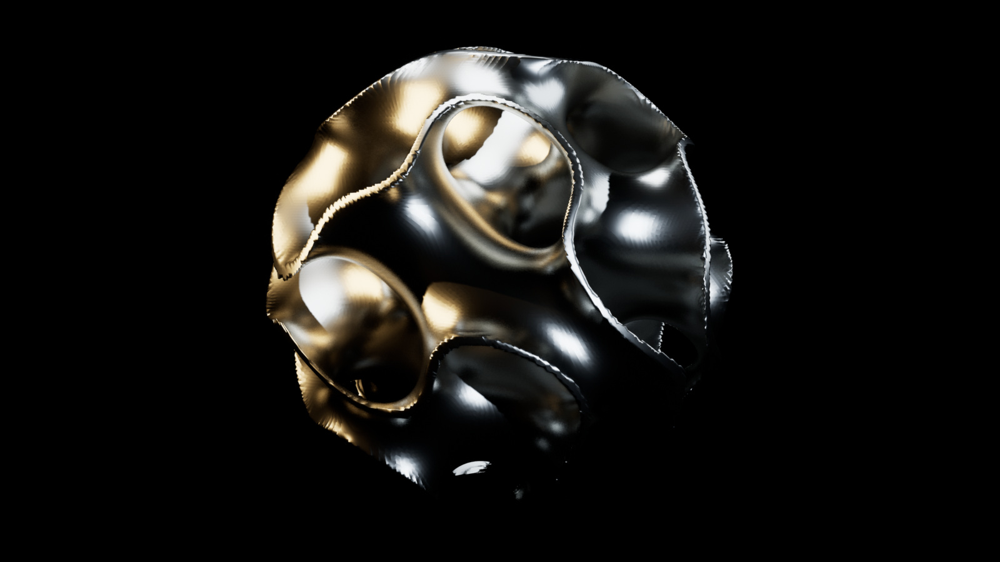

# AUREOLE

**Five seconds of metal shaped by equations.** A metallic lattice twists and
breathes under a moving camera, followed by a walkthrough of the mathematics
that defines it. Created by Adem Vessell / Arkhē with Codex.

[Watch the film and math reveal](https://www.xn--arkh-eva.org/aureole/) ·
[Five-second MP4](web/clean.mp4) · [20-second walkthrough](web/reveal.mp4)

[](https://www.xn--arkh-eva.org/aureole/)

The equations define the geometry, deformation and procedural environment.
Unreal Engine 5.7 supplies the material model, lighting, camera effects and
rendering. This is procedural CGI with inspectable mathematical controls.
The website plays the completed render; it does not run Unreal in the browser.

## How the equations build the shot

### 1. A solid from three waves

$$g(u,v,w)=\sin u\cos v+\sin v\cos w+\sin w\cos u$$

$$F(x,y,z)=\max\left(|g(kx,ky,kz)|-0.16,\frac{\sqrt{x^2+y^2+z^2}}{150}-1\right)$$

The inside rule is $F\leq0$, with $k=1.75(2\pi)/300$ radians/cm.
Coordinates are centimetres. The first term thickens the zero level set of a
trigonometric gyroid approximation; the second clips it to a 150 cm radius
sphere. The thickness is specified in field units, so it is not a constant
physical wall thickness. This nodal approximation is not an exact minimal
surface.

[Marching cubes](geometry/generate_gyroid.py) samples the field on a 192³ grid,
producing 328,572 vertices and 656,980 triangles. The 112³ mesh is retained as a
lower-resolution mathematical control.

### 2. Twist and breathe

For local position $P=(x,y,z)$ and time $t$ in seconds:

$$\phi=2\pi t/5,\qquad \kappa=0.62\sin(\phi-\pi/2),\qquad a=1+0.055\sin\phi$$

$$\theta=\kappa z/150,\qquad q(P,t)=aR_z(\theta)P$$

`Rz` rotates around the vertical axis. Expanded into components:

```text
x' = a (x cos(theta) - y sin(theta))
y' = a (x sin(theta) + y cos(theta))
z' = a z
```

The custom HLSL material in [build_scene.py](scripts/build_scene.py) applies
this deformation through World Position Offset. It also transforms the surface
normals with the inverse-transpose Jacobian, keeping the lighting aligned with
the moving surface. A separate sequenced camera follows a slow arc.

### 3. Build the studio lighting

$$L_j(u,v)=P_j\exp\left[-(d_u/\sigma_u)^4-((v-v_j)/\sigma_v)^4\right]$$

$$E(u,v)=b+\sum_j c_jL_j(u,v)$$

Three soft rectangular panels form a procedural HDR environment. Here $d_u$ is
wrapped horizontal distance to panel $j$, $c_j$ its colour, and $P_j$ its
brightness. [make_studio.py](scripts/make_studio.py) writes the HDR; four Unreal
RectLights complete the setup. There are no stock models, photographs, texture
packs or downloaded HDRIs in the scene.

### 4. Render the scene

The final shot uses a 40 mm camera, a silver material with roughness 0.28,
software Lumen, and Movie Render Queue at **1600 × 900, 24 fps, 120 frames,
16 temporal samples per frame**. The 20-second reveal contains the five-second
shot once, then three replays with equation panels. It contains five seconds
of unique rendered motion.

## Tools and requirements

| Tool | Role |
| --- | --- |
| Python, NumPy, SciPy, scikit-image | Field sampling, mesh generation and numerical checks |
| Blender 5.1.2 | OBJ-to-FBX conversion |
| Unreal Engine 5.7 | Materials, deformation shader, sequencing, lighting and rendering |
| Pillow and FFmpeg/ffprobe | Equation panels, movie encoding and media verification |
| HTML, CSS and JavaScript | Static film player and equation page |
| Codex | Assisted authoring, iteration, packaging and verification |

The recorded render and package smoke test ran on an Apple M1 Max with Metal
SM5 and software Lumen. Hardware ray tracing and Nanite are disabled. The
included Unreal project enables Python scripting and Movie Render Queue.
Unreal, Blender and FFmpeg must be installed separately; pinned Python
packages are in [requirements.txt](requirements.txt). Other operating systems
or engine versions have not been validated by this release.

## Watch locally

The finished movies and self-contained webpage are included. This path needs
only Python's static server:

```sh
git clone https://github.com/AdemVessell/aureole.git
cd aureole
python3 -m http.server 8776 --bind 127.0.0.1 --directory web
```

Open **http://127.0.0.1:8776/**. Film / Math reveal selects the movie; Play,
Replay, the timeline and Full screen control playback. The player loads each
small movie completely when requested, so seeking does not depend on the
host's byte-range support. A poster remains visible during loading or after
playback ends. The page makes no external asset requests.

## Rebuild the geometry and check the math

Start from the repository root. The Python packages generate the geometry,
create the procedural HDR and check the deformation:

```sh
python3 -m venv .venv
source .venv/bin/activate
python -m pip install --upgrade pip
python -m pip install -r requirements.txt
```

The pinned Python dependencies are NumPy, SciPy, scikit-image and Pillow.
Blender and Unreal are external tools and are not installed by the Python
requirements file.

Generate the original 112³ mesh first; the default math verifier intentionally
reads that lower-resolution source mesh. This also provides the byte-identity
control against the canonical original when the same runtime is used. The generated OBJ is not bundled. Both 112³ and 192³ OBJ files reproduced the
reference SHA-256 hashes in a fresh virtual environment; see
[`PACKAGE_RECEIPT.json`](PACKAGE_RECEIPT.json):

```sh
python3 -B geometry/generate_gyroid.py \
  --resolution 112 --radius-cm 150 --periods-across 1.75 \
  --shell-half-width 0.16 --extent-cm 154 \
  --name gyroid_lattice_300cm
python3 -B scripts/verify_math.py
```

Generate the final fine source and procedural HDR:

```sh
python3 -B geometry/generate_gyroid.py \
  --resolution 192 --radius-cm 150 --periods-across 1.75 \
  --shell-half-width 0.16 --extent-cm 154 \
  --name gyroid_lattice_fine
python3 -B scripts/make_studio.py
```

The generator audits empty/non-finite/degenerate/non-manifold output and writes
the OBJ plus JSON sidecar. To make the Unreal-importable FBX, use a local
Blender 5.1.2 CLI (put `blender` on your PATH, or use its full path):

```sh
blender --background --python geometry/export_obj_to_fbx.py -- \
  --obj geometry/gyroid_lattice_fine.obj \
  --fbx geometry/gyroid_lattice_fine.fbx
```

The generated OBJ/FBX/HDR/blend files are ignored by `.gitignore`; source
generation is preferred over storing large binary assets in the repository.

## Unreal Engine 5.7 setup

The minimal project descriptor is `Unreal/Lattice/Lattice.uproject` with its
`Config/` files. On an Apple-silicon M1 Max, use the installed UE 5.7
`UnrealEditor` application binary and set both executable and project path explicitly:

```sh
ROOT="$PWD"
UE_EDITOR="/path/to/UE_5.7/Engine/Binaries/Mac/UnrealEditor.app/Contents/MacOS/UnrealEditor"
projectPath="$ROOT/Unreal/Lattice/Lattice.uproject"
```

The path is intentionally a placeholder: the engine installation is
machine-specific and is not bundled. `scripts/build_scene.py` is run from the
project through the editor command line. It imports the generated
`geometry/gyroid_lattice_fine.fbx` as `GyroidFine` and `geometry/studio.hdr` as
`StudioEnvironment`, creates the Aureole map/material/sequence, and writes
local run receipts under `proof/`:

```sh
"$UE_EDITOR" "$projectPath" -unattended -nosplash -nosound \
  -RenderOffscreen \
  -ExecutePythonScript="$ROOT/scripts/build_scene.py" \
  -abslog="$ROOT/proof/engine-build.log" -stdout -FullStdOutLogOutput
```

Raw engine logs are deliberately not part of this package. The build's
sequence-state receipt is summarized in `proof/SEQUENCE_CHECK_SUMMARY.json`:
the corrected MPC parameter keys use sequence ticks (`120000` for the 5-second
end key), and evaluated `ShotTime`/camera checks pass at frames 0, 30, 60, 90
and 119.

## Preview, full render and reveal

`scripts/render_shot.py` reads `proof/RENDER_REQUEST.json` by default, or a
path supplied through `RENDER_REQUEST_PATH` / `LATTICE_RENDER_REQUEST`. Copy
and edit `proof/RENDER_REQUEST.example.json` for a local run; outputs are
ignored. The request uses an exclusive `frame_end`.

```sh
cp proof/RENDER_REQUEST.example.json proof/RENDER_REQUEST.json
export RENDER_REQUEST_PATH="$ROOT/proof/RENDER_REQUEST.json"
"$UE_EDITOR" "$projectPath" -unattended -nosplash -nosound \
  -RenderOffscreen \
  -ExecutePythonScript="$ROOT/scripts/render_shot.py" \
  -abslog="$ROOT/proof/engine-render.log" -stdout -FullStdOutLogOutput
```

For the documented full reproduction, use 1600×900, frames `[0,120)`, one
spatial sample and 16 temporal samples. `proof/RENDER_REQUEST.example.json`
contains those settings, matching the proven local final render. The output is
120 PNG frames at 24 fps. Inspect the
engine result and frames before encoding:

```sh
ffmpeg -hide_banner -loglevel error -y \
  -framerate 24 -i "$ROOT/renders/example/Aureole.%04d.png" \
  -c:v libx264 -preset medium -crf 18 -pix_fmt yuv420p \
  -movflags +faststart "$ROOT/clean.mp4"
python3 -B scripts/make_reveal.py --input clean.mp4 --output reveal.mp4
export AUREOLE_RENDER_DIR="$ROOT/renders/example"
python3 -B scripts/verify_media.py
```

`make_reveal.py` creates the equation panels using available system fonts;
font differences can change the walkthrough typography. It never re-renders
the 3D shot. To view rebuilt movies in the included player, copy `clean.mp4`
and `reveal.mp4` into `web/`, then restart or refresh the local page. If changing
the published media, update their content-hash query values in `web/review.js`
so cached downloads cannot masquerade as the new files.

## What has been verified

- Fresh pinned Python environment: both source meshes match the reference OBJ
  hashes; geometry is finite, closed and free of degenerate triangles.
- Deformation Jacobian and normal correction checks pass. A deliberately wrong
  no-normal-correction control fails as expected.
- Evaluated Unreal material time and camera checks pass at frames 0, 30, 60,
  90 and 119. Material Parameter Collection keys use sequence ticks: the
  five-second endpoint is 120,000 ticks at 24,000 ticks/second.
- The original full render contains 120 distinct, nonblank frames. Both
  delivered MP4s decode completely with the expected dimensions and duration.
- The portable package rebuilt the Unreal scene and rendered two 320 × 180
  smoke-test frames successfully. This package test did not repeat the whole
  final-resolution render.
- Browser playback, seeking, replay, end state and full screen were checked;
  the missing-media control shows a clear error and retains the poster.

See [PACKAGE_RECEIPT.json](PACKAGE_RECEIPT.json) and the small [proof/](proof/)
summaries for settings, hashes and check boundaries. Generated Unreal Content,
caches, source OBJ/FBX/HDR files and raw machine logs are excluded from Git;
the scripts recreate the scene assets. The final reference movies are included
under `web/`.

## Known limits

The original render completed, then Unreal aborted during ICU/Slate editor
shutdown. The package smoke render also exported its frames before a nonzero
shutdown result. Inspect the render receipt **and** decoded output; a successful
export is not evidence of a clean editor exit.

Sampled clipping edges and approximate realtime reflections remain visible.
This is authored motion, not a simulation of metal mechanics. Identical pixels
across GPUs, engine versions or font installations are not guaranteed. The
compact equations do not independently specify every final pixel: Unreal's
renderer and the full scene setup are part of the result.

Source and media are published for inspection and reproduction. This repository
adds no blanket licence; see [NOTICE](NOTICE) for credits and third-party terms.
